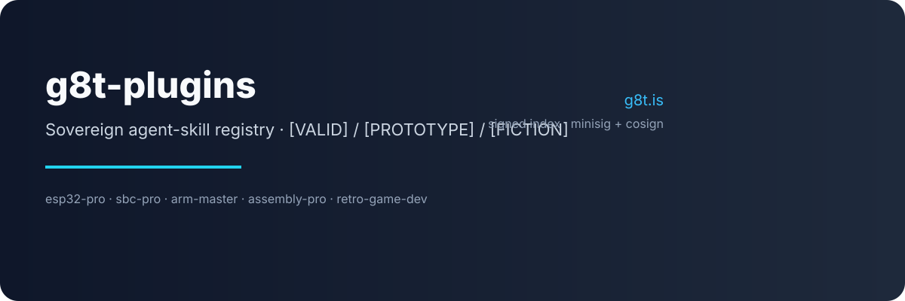

<p align="center">
  
</p>

<h1 align="center">g8t-plugins</h1>
<p align="center">
  <b>Sovereign, agent-agnostic plugin registry for 8b-is skills.</b><br>
  Installs via <code>st plugin</code> (Smart Tree) or directly into <code>~/.agents/skills/</code>.<br>
  Every claim classified <code>[VALID]</code> / <code>[PROTOTYPE]</code> / <code>[FICTION]</code>.
</p>

<p align="center">
  <a href="#plugins">Plugins</a> ·
  <a href="#eli5">ELI5 guide</a> ·
  <a href="#install">Install</a> ·
  <a href="#trust">Trust chain</a> ·
  <a href="#mirrors">Mirrors</a> ·
  <a href="#roadmap">Roadmap</a>
</p>

---

## Plugins

| Plugin | Purpose | Status |
|---|---|---|
| `esp32-pro` | ESP32 / ESP32-S3 embedded firmware, C99, embedded Rust, RISC-V/XTENSA assembly, zero-DC shutter drive | `0.1.0` |
| `sbc-pro` | Linux SBC engineering (Pi 5/4/Zero/CM, RK3588, VideoCore, Panfrost/PanVK, boot chain, thermal) | `0.1.0` |
| `arm-master` | AArch64/ARMv8-A/ARMv9 low-level perf: assembly, NEON/ASIMD, SDOT/FP16, AAPCS64, perf counters | `0.1.0` |
| `assembly-pro` | Multi-ISA assembly: x86-64 SysV, RISC-V psABI, inline asm, perf counters, the three-step ladder | `0.1.0` |
| `retro-game-dev` | Retro console dev: NES (6502), SNES (65816), Genesis (68000), Game Boy (LR35902) | `0.1.0` |

## Cross-skill handoff

```
assembly-pro ──routes AArch64 specifics──► arm-master
      │
      └──routes 6502/65816/Z80/68000──► retro-game-dev
```

`sbc-pro` owns board/OS facts; `arm-master` owns instruction/ISA facts. If the answer
depends on which kernel or GPU stack is installed, hand off to `sbc-pro`. If it drops below
the OS (instruction selection, NEON, ABI, GPU-ISA reality), hand off to `arm-master`.
`retro-game-dev` owns the hardware budget and mapper/MBC; `assembly-pro` owns general asm
discipline for the ladder.

---

<a id="eli5"></a>
## ELI5 guide — what is this, and why should you care?

**The problem:** AI coding agents are confident. They will tell you "hand-write assembly,
it's always faster" or "the emulator passed, so it works on real hardware." Both are wrong,
and the hardware (or your perf counters) will prove it.

**The fix:** `g8t-plugins` is a registry of **skills** — instruction manuals for AI agents
that bake in epistemic hygiene. Every skill carries an `epistemic-ledger.md` that tags each
claim:

| Tag | Meaning |
|---|---|
| `[VALID]` | engineering fact, safe to build on |
| `[PROTOTYPE]` | plausible, must be measured before claiming |
| `[FICTION]` | do not present as engineering |

**Example:** You ask "should I hand-write x86-64 asm for my base64 decoder?"
`assembly-pro` answers: the ledger says SSSE3 `pshufb` base64 beat GCC by 4.8–6.3x on one
kernel, but modern Clang beats hand-asm on secp256k1 by ~20–25%. The correct answer is
"measure on this kernel, this CPU, this compiler" — then it hands you `asm_ladder.sh` to do
exactly that.

**Install once, use everywhere:** the same `SKILL.md` installs into Claude Code, Codex,
Gemini CLI, Cursor, or any agent that reads `~/.agents/skills/`.

---

<a id="install"></a>
## Install

```bash
# Generic agent-agnostic skills folder (recommended)
npx skills add https://g8t.is/registry/esp32-pro

# Via Smart Tree (verifies signatures + ledger before install)
st plugin add esp32-pro

# Claude Code
claude plugin marketplace add 8b-is/g8t-plugins
claude plugin install esp32-pro

# Sovereign CLI (full verification)
g8t plugin add esp32-pro --verify
```

Available plugins: `esp32-pro`, `sbc-pro`, `arm-master`, `assembly-pro`, `retro-game-dev`.

---

<a id="trust"></a>
## Trust chain

`st plugin add` runs three gates before installation:

1. **Registry verification** — BLAKE3 against the signed `registry/index.json`.
2. **Security scan** — plugin artifact through smart-tree's `foreign_patterns` matcher
   (no `npx`, no IPFS gateways, no mutable npm tags).
3. **Ledger hash check** — `references/epistemic-ledger.md` hash must match the signed
   manifest's `ledgerHash`.

Only then does `AiInstaller` write `~/.agents/skills/<name>/` and register MCP/hooks.

Registry `index.json` is signed with **minisign** (offline key) and **cosign** (keyless OIDC).
Each plugin tarball has a matching `.minisig` and `.sigstore.json`. Public keys live at
`https://g8t.is/keys/keys.json` with `keys.json.minisig`.

---

<a id="mirrors"></a>
## Mirrors

- **GitHub** — `https://github.com/8b-is/g8t-plugins` (canonical forge)
- **Codeberg** — `https://codeberg.org/8b-is/g8t-plugins` (metadata only — see `MIRROR.md`)
- **Forgejo** — `https://v13.next.forgejo.org/8b-is/g8t-plugins` (full sovereign mirror)

Codeberg receives `schemas/`, `cli/`, `ci/`, `registry/`, `MIRROR.md`, `PROVENANCE.md`
only. No `plugins/*/SKILL.md` is ever pushed to Codeberg per Codeberg ToU §2(1)7 (LLM-generated
code restriction). The sovereign copy lives on Forgejo.

---

<a id="roadmap"></a>
## Roadmap to v1.0

| Step | Action | Exit criterion |
|---|---|---|
| 1 | Ship all five skills; routing resolves, no dead links | `st plugin list` shows five plugins |
| 2 | 20 trigger evals per skill (5 positive, 5 negative, 5 handoff, 5 adversarial) | F1 > 0.9 across two frontier models |
| 3 | Behavioral evals: unmeasured speed claims, emulator-equals-hardware | Zero fiction promotions |
| 4 | Populate platform files with one working ROM per platform (NES, SNES, Genesis, GB) | Each ROM boots in Mesen 2 |
| 5 | Populate `x86-64.md` / `riscv.md` with measured `asm_ladder.sh` runs | Every performance row has a number |
| 6 | Adversarial pass: each model writes a deliberately wrong answer; the skill catches it | 100% catch rate on fiction list |

---

## What would falsify this design

- **Codeberg removes the metadata mirror anyway.** Mode A collapses to Forgejo-only.
- **Agent Plugins 1.0.0 revises `plugin.json` in a breaking way.** Pin `agentPlugins` in
  `g8t.json` and publish a compatibility matrix.
- **No client consumes the epistemic ledger.** If Claude Code, Codex, and Gemini all ignore
  `references/epistemic-ledger.md`, the differentiator is decorative, not a control.
- **The dual-signature chain is too heavy for contributors.** Cosign-only for community
  plugins; dual-signature mandatory only for `8b-is/` official plugins.

---

## Inspiration: ruflo

This registry is built in the spirit of **ruflo** — small, sharp, agent-agnostic tools that
do one thing well and tell you honestly what they can't. The ledger's `[VALID]`/`[PROTOTYPE]`
`/[FICTION]` split is ruflo's ethos applied to agent skills: build what the hardware
demonstrably does, label the rest, and measure before you optimize.

---

## License

MIT
